# RADUGA Computer
**Step-by-step schematic reverse-engineering process**

### 28.03.2019 Board

A non-working computer board was brought to me from Omsk. Thirteen ICs are missing from the board, leaving only their gold-plated pins behind. Someone probably harvested the chips for precious metals. There is a board modification with one IC soldered on top. Many discrete components are also missing—most likely capacitors or diodes. 

*My actions* 

First, I desoldered the remaining pins. Apparently, some of the "gold" ICs belonged to the K533 or K1533 series. It is also obvious that some of them are address multiplexers, which simplifies tracing the schematic. Worse yet, some traces were damaged when the ICs were clipped off, and some resistors were clipped off too (apparently getting in the way of the scavenging).

The front side of the board suffered heavy oxidation, likely due to aggressive flux that was never washed off. Rosin was used on the back side, but in obscene amounts and also left uncleaned. 

It took about two hundred grams of isopropanol and the same amount of 646 solvent to wash it all off. However, some traces under the flux were partially destroyed.

It has now become clear that this is the very first Raduga board. The initial factory boards were somewhat defective: the vias were too small, the fiberglass PCB material wasn't great, the copper adhered poorly to it, and the traces—including the power rails—were too thin. It was decided to modify the boards and assemble the first prototype from them for testing. The first prototype differed from the final Raduga, though I can't say how right now.

Other board flaws:

- Discrete components (resistors, diodes, capacitors) are packed into DIP footprints.
- 90-degree trace angles.
- Traces often approach a pin from the side (meaning the trace first runs between pins and makes a 90-degree turn once aligned with the pin).

All of the above complicates routing, assembly, and debugging.

## 29.03.2019 ROM

Two of the three ROMs on the board were in sockets, but turned out to be dummies. Even though one of them is a 2764, the PCB traces show that all three footprints are actually wired strictly for 2716 (573RF5). 

The third, soldered-in ROM has "ЗН" (CG - Character Generator) written on it in pencil. Probably "character generator," which makes sense. I couldn't desolder the chip—the pins sit too tightly in the mounting holes with virtually no clearance. 

After cutting power to the IC and hooking up a programmer to the neighboring socket, I read the contents multiple times; the data is consistent and matches every time. 

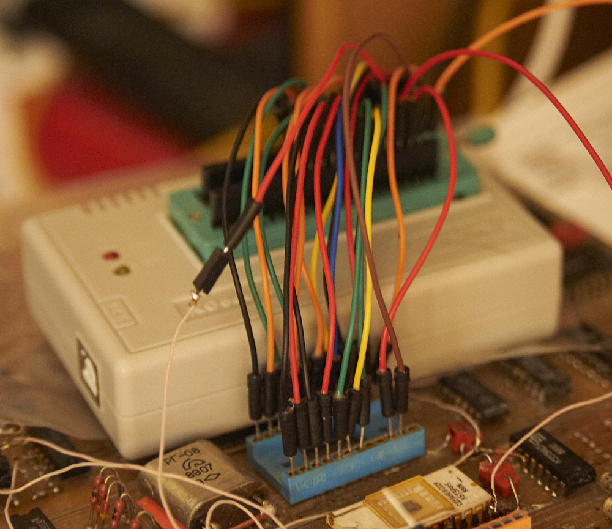

However, the data itself is "garbage". :(  

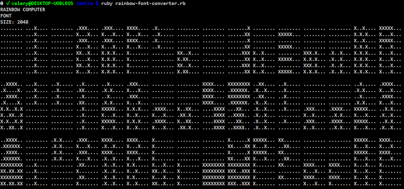

### 30.03.2019 Keyboard (Decoder)

A 1555ID3 is installed for keyboard scanning. Its outputs are connected to the connector through 13 diodes. 

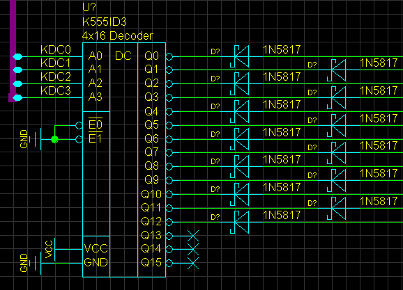

The decoder inputs are connected to parallel port (1)—the system uses two of them, let's conventionally call them PPI1 and PPI2.

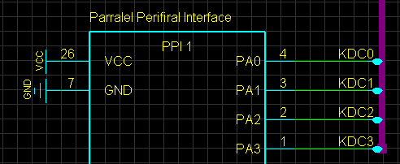

### 30.03.2019 RAM

The board has 16 565RU5 ICs and 4 589AP16 ICs installed. Eight of the 16 memory ICs are also connected to a 589IR12, whose pins connect to a 155IR1. The other eight ICs have two 589IR12s and two 155IR1s as well. The circuit is very similar to the "Specialist" computer. However, unlike the "Specialist," the data inputs and outputs of the memory ICs are tied together. The inputs and outputs of the bus transceivers are also tied together; this was done to simplify PCB routing.

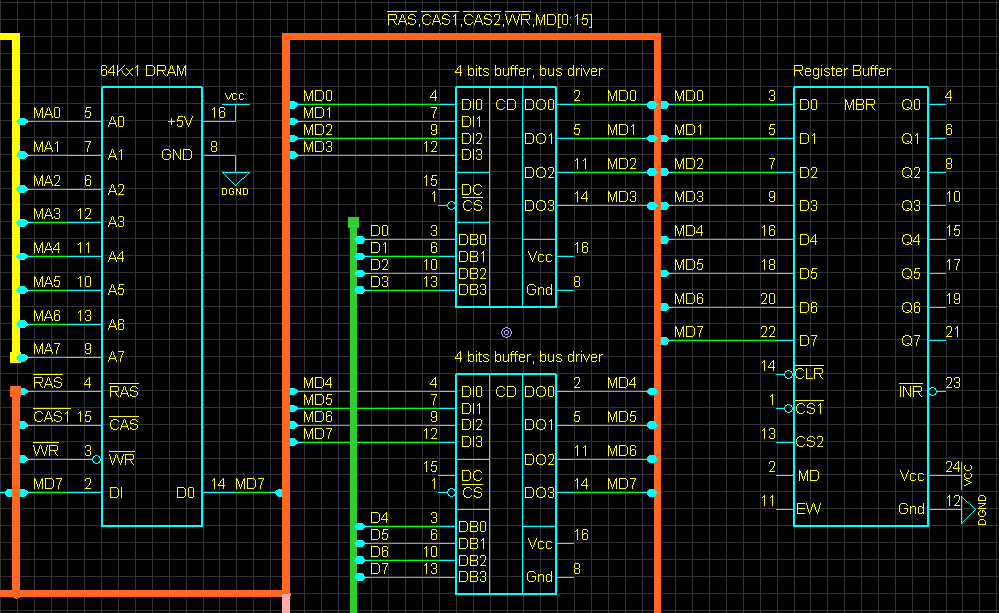

The ~RAS and ~WE signals are tied together across all ICs, while ~CAS is separate for each byte.

The extra 589IR12 has tied inputs and outputs—apparently, this is the "copier," which we also used to call the "transfer register".

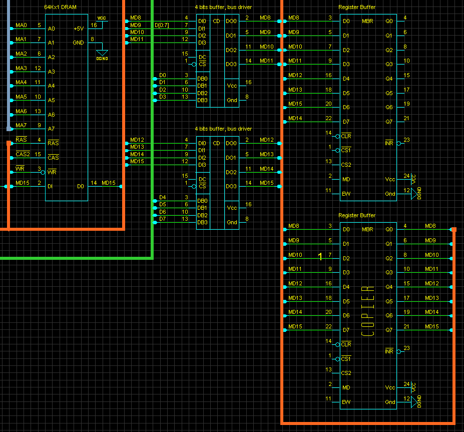

Pin 6 of all four shift registers is tied together, while pin 9 of the ICs responsible for color is connected to ground. Their pin 8 is connected to pins 8 and 9 of the registers responsible for pixel brightness.

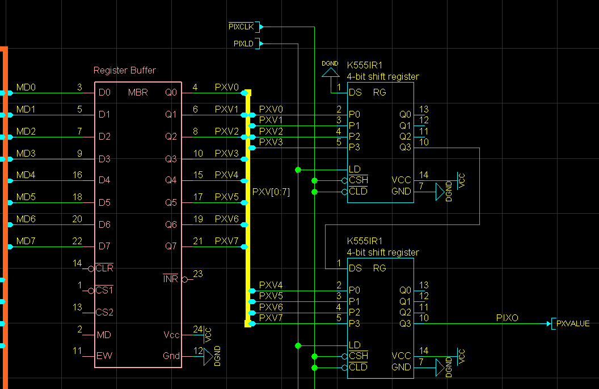
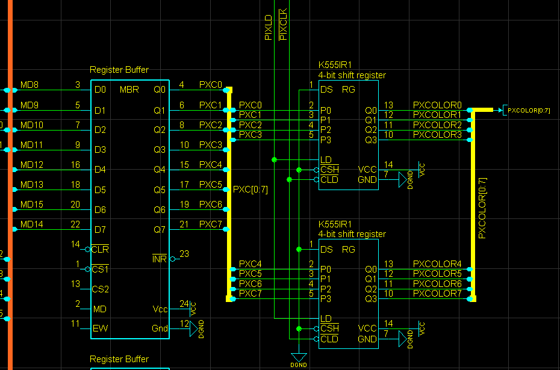

*Sound*

The VI53 timer generates three frequencies, each having an 8-step logarithmic DAC. 

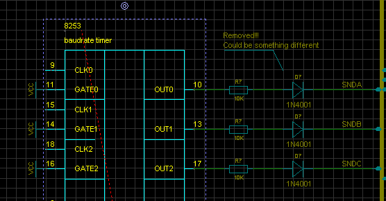

The DAC ICs are missing, though I assume 533ID10s were used. Each decoder uses only three inputs and 8 outputs. The resistors survived, and their values are legible.

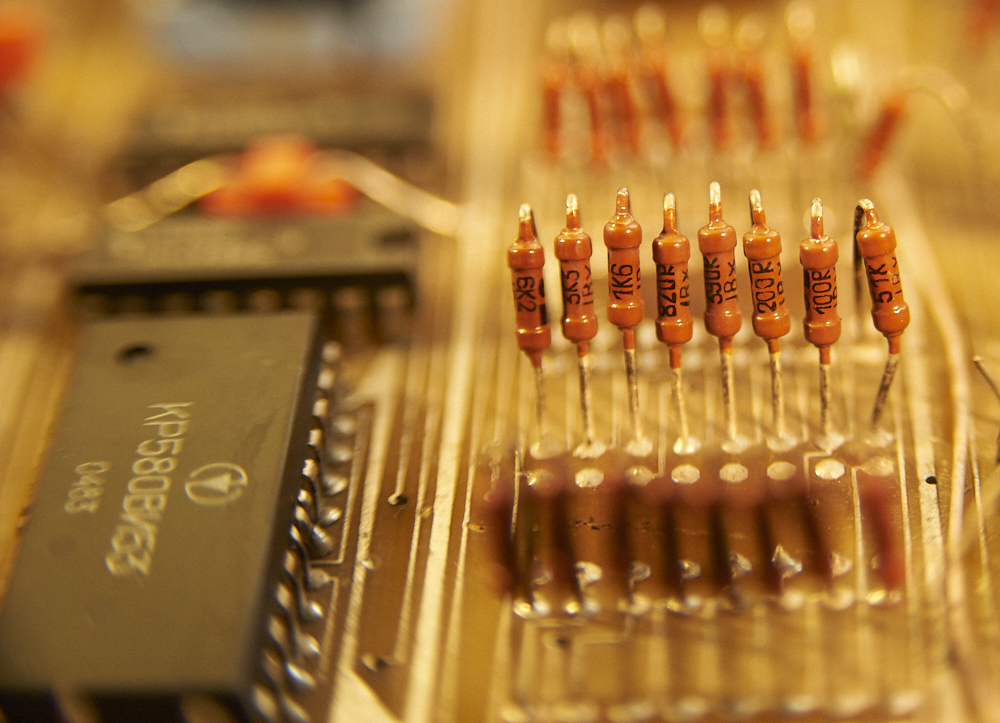

This yields roughly the following schematic.

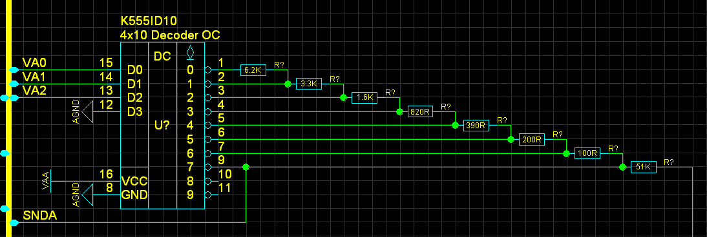

I remember that an 8-step logarithmic scale was chosen specifically for minimization. You can't strictly call the scale logarithmic; rather, it approximates a logarithm. The resistor values differed by roughly a factor of two, and they were connected in series in the circuit. The deviations from exact doubled values were selected to achieve a more or less acceptable result with very modest circuitry.

There are four channels in total (ABCD), with the fourth one used for noise.

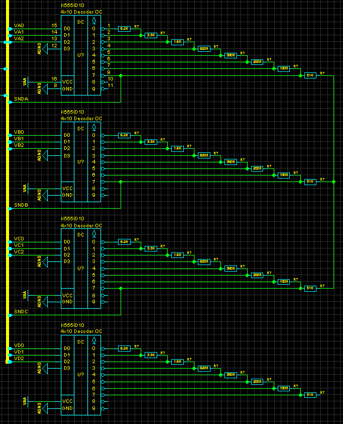

The inputs of the DAC decoders are connected to programmable parallel ports (1) and (2)

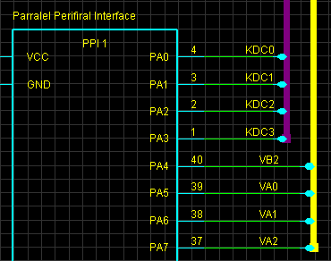
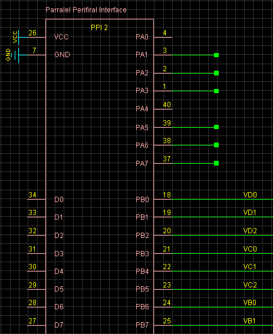

Maximum signal volume is achieved with a decoder input value of 0, and minimum volume at a value of 7.
This results in the following relationship between the decoder input value (X-axis) and the lower divider leg value (Y-axis).

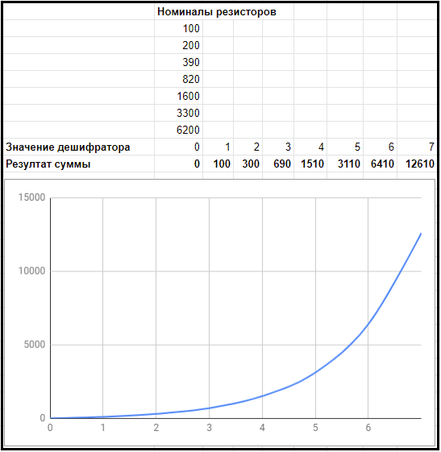

I remember that early versions of the boards had a "rustling" and crackling sound during volume transitions. This was caused by an electrolytic capacitor recharging in the audio path. The issue was later resolved. 

A quirk of this circuit design is that by programming the timer to output a constant high (1), the system could play audio solely by modulating the volume. This was done intentionally and borrowed from the MSX PSG.

### 01.04.2019 COLORS

Following the pixel and color registers is a multiplexer and one of two palette options. Theoretically, the multiplexer outputs one of four color variants.

| COLSELECT | Result |
|-----------|--------|
| 0 | Lower color nibble from the color buffer |
| 1 | Upper color nibble from the color buffer |
| 2 | Border color |
| 3 | Zero color |

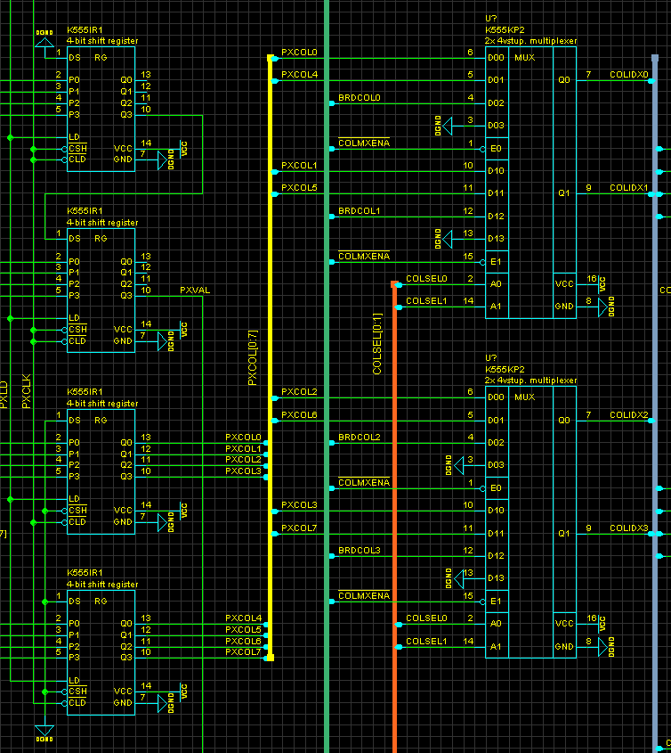

The border color comes from programmable parallel port PPI 1. 

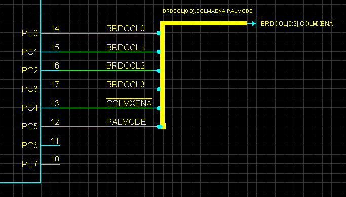

### 02.04.2019 AUDIO AMPLIFIER

The amplifier is built around half of a 548UN1A, with the output stage using KT814 and KT815 transistors. Most of the amplifier's discrete components are missing from the board. Therefore, I will redraw the amplifier schematic from scratch. 

The second half of the IC houses a noise generator for the audio system. It likely uses a KT3102 with its base grounded, collector unconnected, and emitter feeding somewhere into the op-amp.

### 02.04.2019 TAPE RECORDER AMPLIFIER

On this board, it is built around a 140UD6. The circuit resembles the one in the SPECIALIST, though with some differences. However, once again, there aren't enough components left on the board to replicate this exact variant. I will use the variant from the SPECIALIST. The circuit output connects to PPI1.PB7

### 03.03.2019 CRT Controller

Progress has been made on the sync generator schematic. It largely mirrors the schematic from the SPECIALIST.

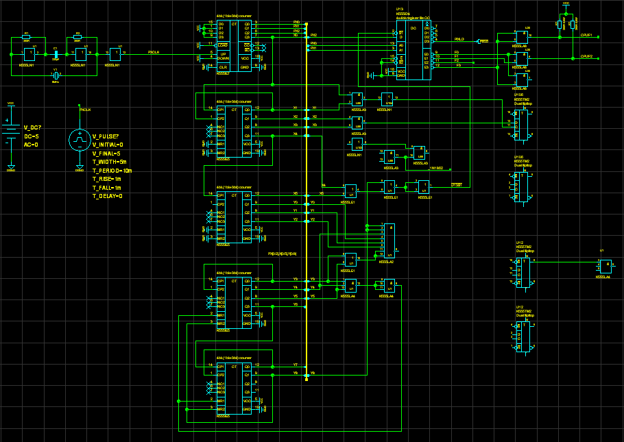

### 09.04.2019 System Connector

After a short break, the expansion connector has been partially traced. Apparently, besides the keyboard, a parallel interface is routed to the connector—possibly a printer or general-purpose expansion port.

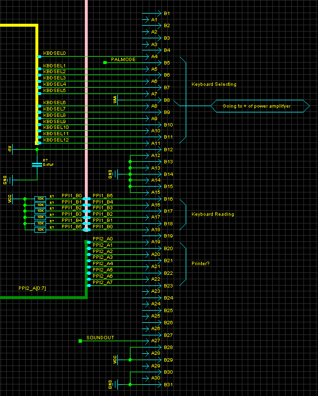

### 11.04.2019 System Connector

Two 8-bit ports of PPI2 are connected to the expansion connector. This allows connecting various peripherals with a programmable interface: a printer, joystick, Covox, or FDD controller

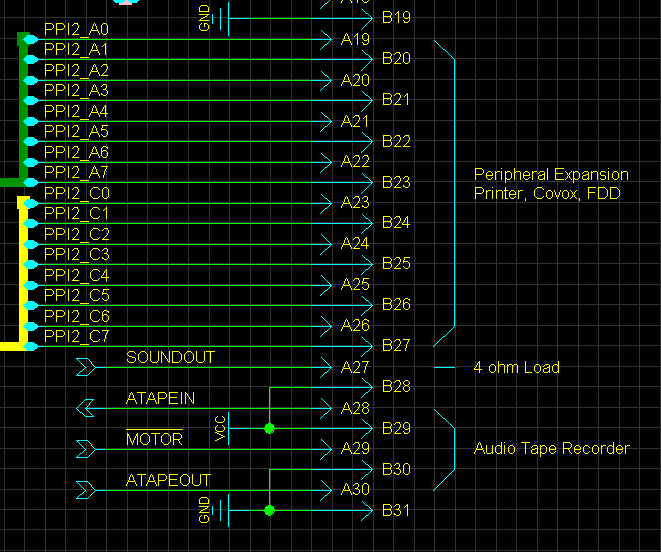

Thus, the functions of PPI2 can be considered completely understood. The only exception is that it's unclear how they were used by a peripheral device or inside the computer's case. Perhaps some pins went to a rear-panel switch, or maybe an LED was connected to some of them.

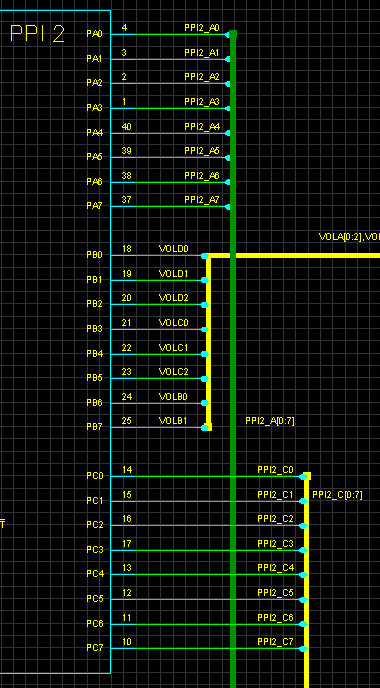

The functions of PPI1 can be considered almost completely understood. The exception is PPI1.PB6, whose purpose remains unknown for now.

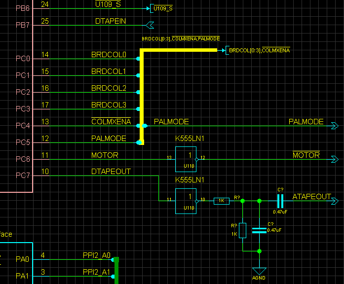

*Small note:* _Connecting PPI1 and PPI2 pins to the system connector does not give the full picture of their on-board usage. Further investigation may show that some of these pins serve an internal function on the board._ 

### 13.04.2019 Font Attempt 2

While tracing the schematic, an interesting short circuit was found on the address bus. That could have caused the soldered-in ROM to read incorrectly. I decided to desolder the ROM. First, excess solder was removed, then the IC pins were tinned with Rose's metal. Next, it was heated with a hot air gun to 150 degrees, and it simply dropped out of its footprint.

Reading the data yielded a different result (file here [ROM](../rom/rainbow-font.BIN)) 

The font looks like the following image.

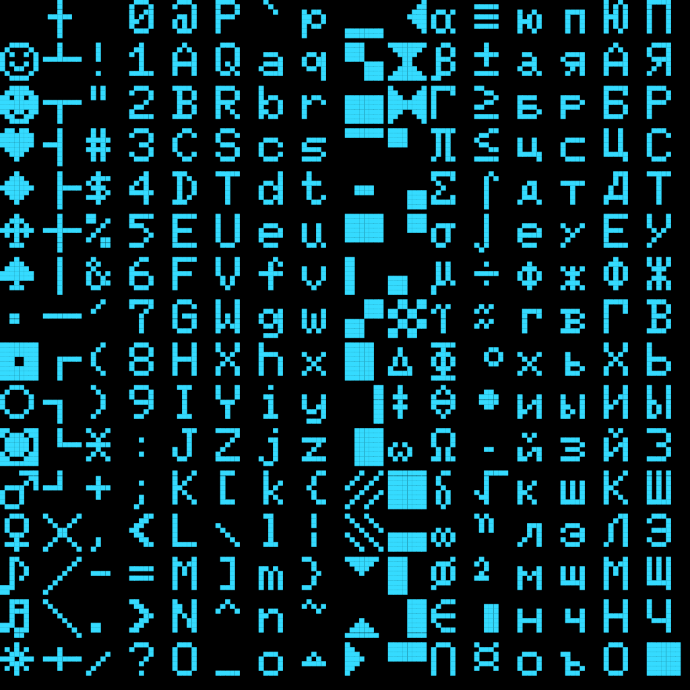

The character size is 5x7, so theoretically, a monochrome screen could display 64 characters per line. Unfortunately, the coveted 80 characters weren't there, though 64 is still better than 48.

It's impossible to say whether this font was final or used only in the prototype. However, even if the font changed to 7x7, the character encoding is unlikely to have changed. And the encoding should match the MSX encoding.

### 13.04.2019 Defective DRAM

The prototype uses defective memory ICs where the upper ROWS line is missing. Indeed, I remember that chips with only half of their memory functional used to arrive and were put to use.

### 14.04.2019 Brief Progress Report

- CRT controller traced to about 99%
- CPU at 90%
- INT controller at 90%
- COPIER at 80%
- Peripheral & Sound at 99%
- DRAM & MUX at 99%

We can very roughly outline the memory map.

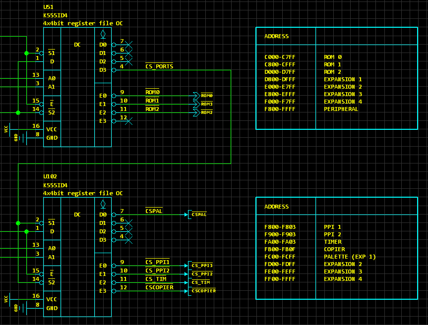

### 15.04.2019 COPIER

The "copier" schematic has taken shape; it's fairly simple, though it took some effort to figure out the signals it uses.

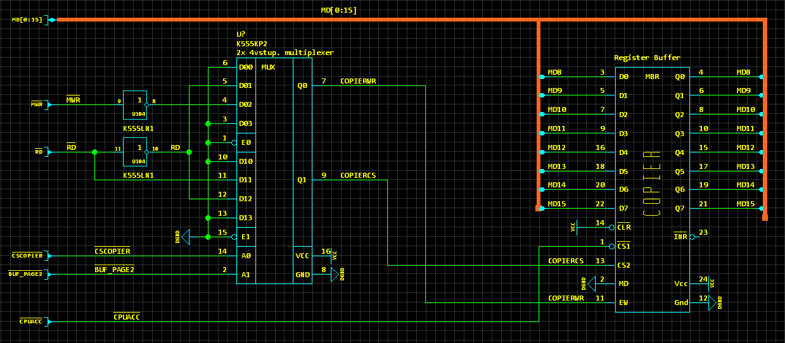

Here is how the logic of this circuit might work.

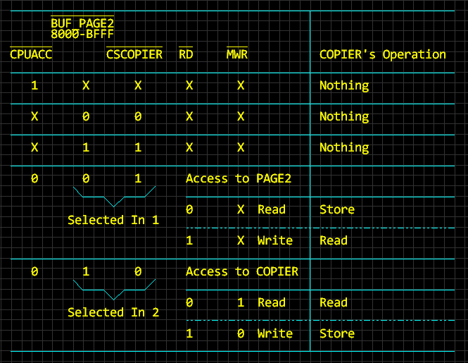

In other words, you can read and write at the copier address FB00. 
Alternatively, reading data from page 2 (8000-BFFF) modifies the "copier" with color. Writing to page 2 modifies the color buffer with the copier's contents.

No other copier modes are apparent, at least on this board. I think the exact same thing could have been in the final product.

## 18.04.2019 First Alpha Version of the Schematic

Well, that's it—the first version of the schematic has been published. What remains is to find and fix errors, then renumber the REFDES and add decoupling capacitors to the schematic.

[Schematic A2](../sch/raduga_computer_sch_a2.pdf)

Wherever possible, IC numbering matches the SPECIALIST, starting from U99 and onward for Raduga's own ICs.

## 20.04.2019 Volume DAC and Mixer (Diagram)

Mixing two channels:

1) 1 kHz (with a -1 volume envelope at 400 Hz)
2) 5 kHz (with a -1 volume envelope at 800 Hz) 

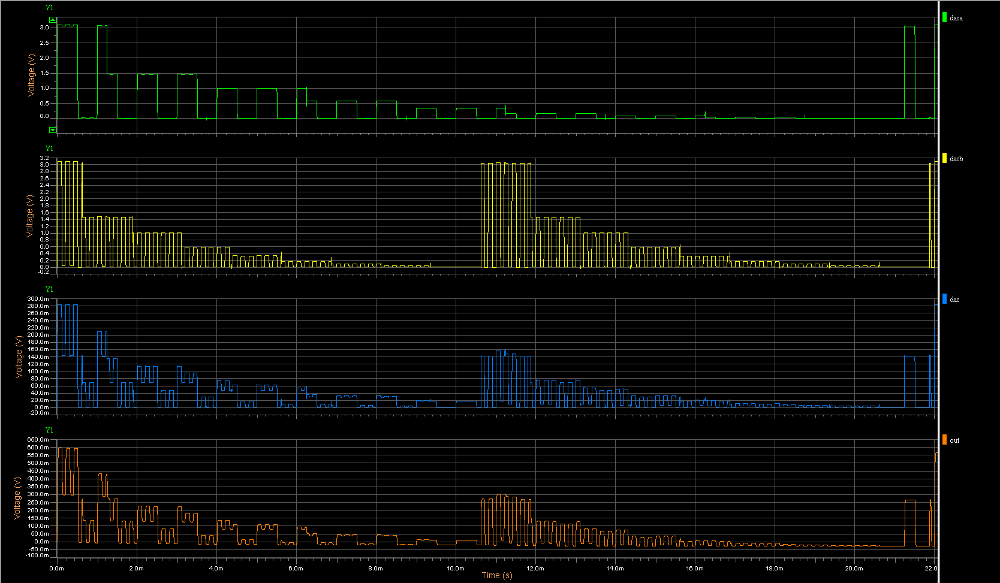
 
Mixing two channels:

1) 1 kHz (with a -1 volume envelope at 400 Hz)
2) 5 kHz sine wave simulating noise (with a -1 volume envelope at 800 Hz) 

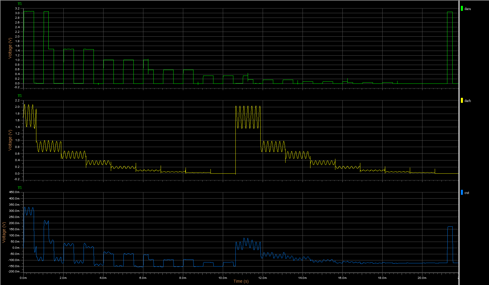
 
## 20.04.2019 RGB DAC (Diagram)

Linear channel brightness ramp (8 MHz) and sync signal

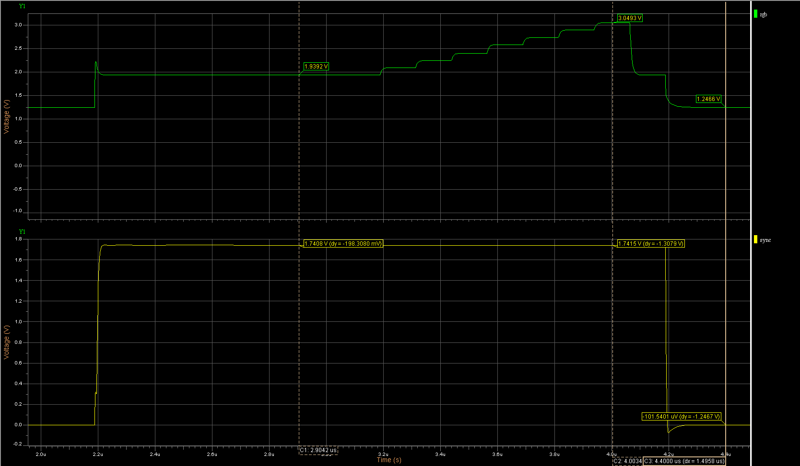

## 21.04.2019 Print-Friendly Schematic

Schematic colors have been converted to print-friendly versions.

- Schematic diagram [in color](../sch/raduga_computer_sch_a2.pdf)
- Schematic diagram [in monochrome](../sch/raduga_computer_sch_a2_bw.pdf)

This is the final update for the alpha version. From this point forward, the refdes will be renumbered.
